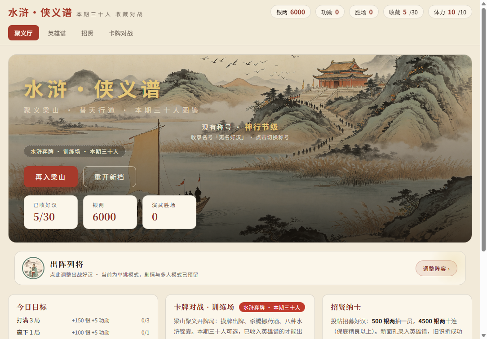

# 水浒·侠义谱 · Water Margin Card Duel

> 一句话：一个**单文件 H5 水浒卡牌对战游戏**——收好汉、配阵容、打牌局，纯前端、离线可玩。



**在线玩**：<https://tlac12345.github.io/shuihu-xiayipu/> · 手机上「添加到主屏幕」体验更好。

---

## 中文

### 这是什么

以《水浒传》为题材的单机卡牌小游戏。本期图鉴 30 位好汉，收齐点亮天罡地煞星图；牌局是「水浒弈牌」玩法——摸牌出牌，靠杀、闪、药、酒和八种锦囊把对面打服。

不联网、不登录，进度存在浏览器本地。

### 玩法

| 模块 | 说明 |
|---|---|
| **聚义厅**（首页） | 银两 / 功勋 / 体力（10 点上限，200 银两换 3 点）、每日目标（打满 3 局、赢 1 局、招 1 次） |
| **招贤** | 500 银两抽一员，4500 银两十连（保底精良以上）；新面孔录入英雄谱，旧识折成功勋 |
| **英雄谱** | 本期 30 人；每员有立绘、兵器与独门绝技（被动 + 主动），收齐点亮星图 |
| **卡牌对战** | 水浒弈牌：摸牌出牌，杀 / 闪 / 药 / 酒 + 八种锦囊；**已收入英雄谱的才能出战** |
| **敌手录** | 朝堂奸佞、豪强恶霸、方腊乱党，数十名敌手 |
| **称号** | 达成条件解锁，首页可查看与切换 |

当前为**单挑模式**，剧情与多人模式在代码里已预留。

### 怎么玩

```bash
# 在线（推荐）
# 直接打开 https://tlac12345.github.io/shuihu-xiayipu/

# 本地
python -m http.server 8000
# 然后浏览器打开 http://localhost:8000
```

### 技术

- 纯前端，单文件 `index.html`（约 380 KB），**零依赖、零构建**
- 立绘与背景在 `assets/`（108 位好汉 + 数十敌手）
- 进度存 `localStorage`，清缓存会丢档
- 适配移动端安全区

---

## English

A single-file HTML5 card-battle game set in *Water Margin* (水浒传). Collect 30 heroes, build a lineup, and win duels with a card system built on Attack / Dodge / Heal / Wine plus eight tactic cards.

- **No build, no dependencies** — one `index.html` (~380 KB) plus art in `assets/`
- **Offline & local** — no account, progress in `localStorage`
- **Play now**: <https://tlac12345.github.io/shuihu-xiayipu/>

| Feature | Notes |
|---|---|
| **Gathering Hall** | Silver, merit, stamina (10 max, 200 silver = 3 stamina), daily goals |
| **Recruit** | 500 silver for one hero, 4500 for a 10-pull (guaranteed rare+) |
| **Hero Codex** | 30 heroes this season, each with art, weapon and a passive + active skill; collect all to light the star chart |
| **Card Duel** | Draw & play: Attack / Dodge / Heal / Wine + 8 tactic cards; only collected heroes can fight |
| **Foe Codex** | Dozens of opponents from court villains to Fang La's rebels |
| **Titles** | Unlock conditions, switchable on the home screen |

Single-duel mode for now; story and multiplayer hooks are already in the code.

---

## 声明 / Notice

个人作品，非商业用途。题材取自《水浒传》公版文本；游戏内立绘与界面素材随仓库分发。
Personal project, non-commercial. Based on the public-domain text of *Water Margin*; all in-game art ships with this repository.
